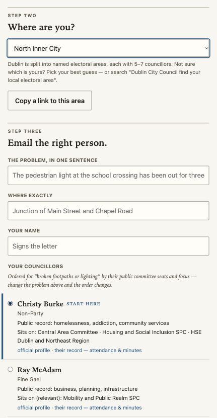

# Karl Doyle

**Engineering Leader · Hands-on Product Engineer · Developer Experience · Applied AI**

I build and scale engineering teams, then stay close enough to the work to help ship the systems those teams need. My work connects product engineering, delivery reliability, developer experience and practical AI.

📍 Dublin · UK right to work · Open to roles across Europe and the UK.

## Start here

| Your interest | Start with |
| --- | --- |
| Engineering leadership, delivery health and responsible metrics | [Baseline / delivery-health-kit](https://github.com/KarlDoyle/delivery-health-kit) |
| Applied AI, retrieval and grounded code analysis | [Quarry](https://github.com/KarlDoyle/quarry) |
| AI-assisted ticket routing and refinement | [Marshal](https://github.com/KarlDoyle/marshal-public) |
| Explicit AI routing and human-approved workflows | [Moss](https://github.com/KarlDoyle/moss-public) |
| Reusable AI engineering standards and templates | [AI Starter](https://github.com/KarlDoyle/ai-starter-public) |
| A live, privacy-conscious public product | [Councillor Tool](https://github.com/KarlDoyle/councillor-tool) |
| Operational developer tooling and review-flow health | [PR Watch](https://github.com/KarlDoyle/pr-watch) |

## What I bring

- **Team development:** grown engineering teams, hired and onboarded engineers, and supported progression into engineering management.
- **Customer-facing performance:** led work to reduce latency and server errors on a high-traffic customer journey.
- **Operational improvement:** simplified cross-functional processes and expanded automated testing for business-critical systems.

## How I work

I favour small, testable systems with clear ownership and deliberate trade-offs.

- **Start with the workflow problem** and ship a useful first version.
- **Use metrics to support improvement:** team-level context, transparent proxies and human judgement.
- **Make quality visible:** tests, CI, reproducible demos and documentation of current behaviour and limitations.

## Selected work

### [Baseline — engineering delivery health](https://github.com/KarlDoyle/delivery-health-kit)

Local-first, team-level delivery and reliability reports for engineering leaders. It combines GitHub, PagerDuty, Sentry and Prometheus signals with deterministic calculations and explicitly labelled proxies to guide investigation.

**Demonstrates:** responsible measurement, adapter design and data provenance.

[Visual: offline CLI report using fictional sample data](https://github.com/KarlDoyle/delivery-health-kit/blob/main/docs/demo.svg)

### [Quarry — local-first codebase retrieval](https://github.com/KarlDoyle/quarry)

Indexes code locally and combines semantic and keyword search. Retrieved source files ground the analysis prompt, with instructions to cite them. Local Ollama is the default; hosted analysis is explicit opt-in. Generated answers still need review.

**Demonstrates:** hybrid retrieval, grounded analysis design and evaluation honesty.

[Visual: real local answer with source-file citations — illustrative, not a benchmark](https://github.com/KarlDoyle/quarry/blob/main/docs/quarry-demo.svg)

### [Marshal — code-grounded ticket routing](https://github.com/KarlDoyle/marshal-public)

Marshal is an experimental local-first CLI for engineers triaging thin tickets. It uses Quarry’s code retrieval and CODEOWNERS to suggest likely ownership, with heuristic confidence and runner-up scores. An optional local LLM produces a reviewable draft implementation brief, with unsupported file suggestions flagged. Generated acceptance criteria can describe existing behaviour, so the draft still needs source review.

[Read the project README](https://github.com/KarlDoyle/marshal-public#readme) · [Validation notes](https://github.com/KarlDoyle/marshal-public/blob/main/docs/VALIDATION.md)

### [Moss — explicit AI workflow routing](https://github.com/KarlDoyle/moss-public)

An experimental TypeScript CLI for routing prompts between configured local and hosted AI providers, with bounded context, usage estimates and human-approved text patches. Routing and failure handling are regression-tested; live provider interoperability remains unverified. **Experimental; not release-ready.**

**Demonstrates:** deterministic routing, failure handling and human-controlled AI workflows.

[Visual: actual route inspection — not model-quality evidence](https://github.com/KarlDoyle/moss-public/blob/main/docs/assets/route-preview.png) · [Readiness review and limitations](https://github.com/KarlDoyle/moss-public/blob/main/docs/READINESS_REVIEW.md)

### [AI Starter — engineering-ready AI templates](https://github.com/KarlDoyle/ai-starter-public)

Copyable starting points for AI applications, with engineering guardrails built in.

Next.js, Python service and local keyword-retrieval templates each include tests, CI, security guidance and configuration copied from a shared engineering standard. The optional local AI reviewer is advisory; a human owns the merge decision.

**Demonstrates:** AI engineering standards, developer enablement, template design, testing, security guardrails and human-owned AI review.

[Visual: copied Python template passing engineering checks — not model-quality evidence](https://github.com/KarlDoyle/ai-starter-public/blob/main/docs/ai-starter-demo.svg)

### [Councillor Tool — civic product](https://github.com/KarlDoyle/councillor-tool)

A live tool helping residents in Dublin City and Dún Laoghaire–Rathdown find councillors and draft an email. No accounts, tracking or backend; emails open in the resident’s own mail app. Official open data is refreshed with link validation and last-good fallback.

**Demonstrates:** public-interest product delivery, open data and maintainability.

[Explore the live interface](https://karldoyle.github.io/councillor-tool/)  

_Real screenshot of the live interface with an example selection; no personal details entered._

### Other developer tooling

- **[PR Watch](https://github.com/KarlDoyle/pr-watch):** a Python CLI tracking business-hours review waits, with Slack digests, breach alerts and PagerDuty on-call lookup. The CLI has no third-party runtime dependencies; the optional GitHub App path is undeployed.
- **[PR Latency Reporter](https://github.com/KarlDoyle/pr-latency-reporter):** local SQLite storage and weekly/monthly Markdown reports on GitHub review activity, with business-hours latency and optional Slack delivery.
- **[Sprint Report Generator](https://github.com/KarlDoyle/sprint_report_generator):** a Jira CLI using changelog history to separate planned work from mid-sprint additions, with multi-team rollups.

## Applied AI approach

Keep sensitive context local where appropriate and make hosted-provider choices explicit. Separate deterministic calculations from model reasoning, distinguish smoke tests from representative evaluations, and keep humans accountable for architecture, review and release.

## Currently exploring

Local-first AI workflows, codebase retrieval quality and practical engineering-health signals.

## Let’s connect

For senior engineering, technical leadership or engineering management roles—or consulting and collaboration on developer tools and applied AI—[message me on LinkedIn](https://linkedin.com/in/karldoyle-em).
